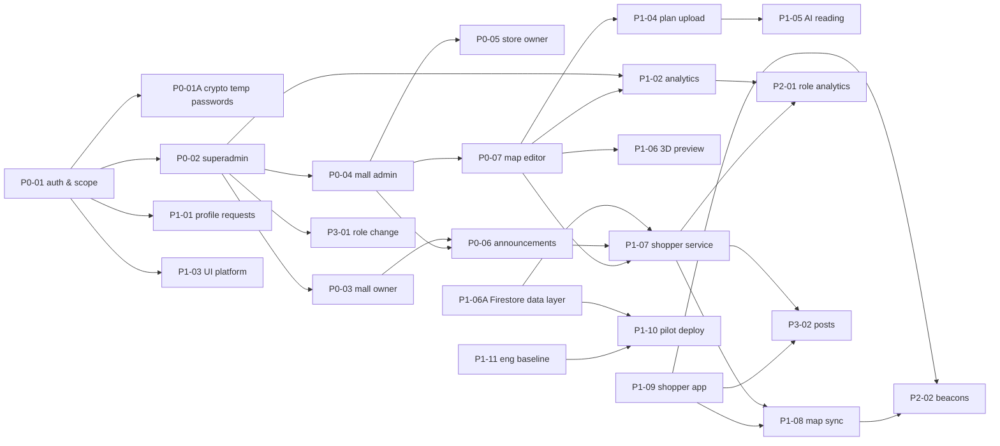

# LIQo — Feature Pipeline

> **Version**: 1.0 | **Date**: 2026-10-22 | **Status**: Living document
> **Why**: `LIQO_PRD.md` · **How**: `LIQO_MASTER_BLUEPRINT.md` · **Where**: this file
> Written to `Engineering Standards.html` Appendix B.3. Covers the admin web, the backend, the shopper app, deployment and the engineering setup.

---

## 1. How to Use & Conventions

This file answers two questions and no others: **what is the state of X**, and **what is next**. Why a feature exists lives in the PRD; how it is built lives in the Blueprint. A fact that appears in two of the three documents means one copy should be deleted.

**IDs are permanent.** An ID is allocated once, when the entry is filed, and never changes: not when the feature is re-tiered, not when it ships, not when it is cancelled. The prefix records the tier it was *filed* in; the current tier is the `Tier` row. Renumbering breaks every reference to the old ID.

**Insertion is by letter suffix.** A feature that must sit right after `P0-01` becomes `P0-01A`. Nothing renumbers, ever.

**Append-only.** Shipped entries move to §6 with their ID intact. Nothing is deleted.

**No dates, no percentages, no estimates-as-commitments.** Effort is S/M/L. Status comes from §2's legend.

**Who may do what.** Anyone working on LIQo may add an entry. Only the product owner (dev4@dynamiqes.com) changes a `Tier`, and the change needs an updated `Why this tier` line.

**Sync.** This file moves in the same change as the code it describes (Definition of Done item 12).

**Totals are generated** once the totals script exists (P1-11). Until then they are counted by hand.

**Live page.** https://claude.ai/artifact/8QeFNHg6Xhp1jSQaMsSUx1 shows this file to the team. `tool/pipeline-data.mjs` reads it, and a project hook (`.claude/settings.json`) rebuilds the page data after every edit and has the session push it. So that the page reads well and parses: every active entry ends with a checklist of what is left, written in plain words; an item waiting on the product owner starts with `Owner:`; the build order in §4 is a numbered list.

**Current totals** *(counted by hand 2026-10-23)*: active P0 3 · P1 8 · P2 2 · P3 2 · archived 9 · total 24

**Before the full artifact chain exists** (P1-11), the `Intent`, `Spec`, `Plan` and `PR` rows point at what plays those parts today: the user story or owner request (intent) and the round's decision doc in `docs/` (spec and plan). The git repository (https://github.com/DynamIQ-Enterprise-Solutions/LIQo) started on 2026-10-22: `PR` reads "n/a (built before the repository)" for work done before then, "none yet" for work still to come, and names the commit or pull request from now on.

---

## 2. Status Legend & Tier Definitions

| Status | Meaning |
|---|---|
| `PLANNED` | Filed, not started |
| `IN PROGRESS` | Being built, or built with open items still listed in the entry |
| `BLOCKED` | Cannot proceed; the blocker is named in `Dependencies` |
| `DONE` | Every §5 item ticked or waived; entry moves to §6 |
| `CANCELLED (reason)` | Will not be built; reason mandatory |

That is the whole set. It is closed on purpose.

| Tier | Test |
|---|---|
| **P0** | The system is not usable without it |
| **P1** | Not releasable without it |
| **P2** | Not sellable without it |
| **P3** | Wanted, unscheduled |

**PRD priority → tier:** `High → P0/P1`, `Medium → P2`, `Low → P3`. Tiers confirmed by the owner on 2026-10-22.

---

## 3. The Ledger

Active entries only. Done entries are in §6.

### 3.1 P0

#### P0-01A — Cryptographic temporary passwords

| | |
|---|---|
| Description | Generate temporary passwords with `crypto.randomInt` instead of `Math.random`. |
| Why this tier | Temporary passwords are the first credential of every account. A predictable generator weakens sign-in for everyone. Inserted after P0-01 by letter suffix. |
| Tier | P0 |
| PRD / Blueprint | PRD §6.1 · Blueprint §4.1 |
| DB | none |
| Backend | `src/utils/password.js` `generateTempPassword()` |
| Frontend | none |
| Effort | S |
| Dependencies | — |
| Status | `PLANNED` |
| Intent | Found while writing the Blueprint (2026-10-22) |
| Spec | Blueprint §4.1 |
| Plan | — |
| PR | none yet |

- [ ] Make temporary passwords from a secure random source

#### P0-02 — Superadmin administration

| | |
|---|---|
| Description | Malls, branches, accounts through wizards, mall-owner assignments, platform settings, audit log, overview. |
| Why this tier | Nothing exists for any other role until a superadmin has created the malls, branches and accounts. |
| Tier | P0 |
| PRD / Blueprint | PRD §6.2 · Blueprint §4.3, §4.4, §4.10, §4.11 |
| DB | `malls`, `branches`, `supervisor_assignments`, `mall_admin_assignments`, `platform_settings`, `audit_log` · migrations 001, 002, 006 |
| Backend | `routes/accounts.js`, `malls.js`, `branches.js`, `assignments.js`, `settings.js`, `audit.js`, `lookups.js` |
| Frontend | `features/accounts/`, `features/malls/`, `features/settings/`, `features/audit/`, `features/overview/` |
| Effort | L |
| Dependencies | P0-01 — every route needs sign-in and scope |
| Status | `IN PROGRESS` |
| Intent | US-005 – US-011 |
| Spec | `docs/round-2-superadmin.md`, `round-4`, `round-8`, `round-10` |
| Plan | same docs, "Changes" sections |
| PR | none yet |

- [x] Accounts, created through step-by-step wizards (US-006)
- [x] Malls and branches (US-007, US-008)
- [x] Mall-owner assignments (US-009)
- [x] Platform settings (US-010), in two columns (AI floor-plan reading; Sign-in & security and General) with − / + numbers and one save bar (`docs/round-18-accuracy-3d-easy-editor.md`, `round-19`)
- [x] Record pages: a header card, short cards side by side in pairs, lists full width, the danger zone last (`docs/round-20-record-pages.md`)
- [x] Requests & reports: profile changes, AI credit requests and problem reports in tabs with counts; problem reports from the top bar with a thread (`docs/round-19-ai-credits.md`)
- [ ] Owner: try Requests & reports and a problem report in a browser (TESTING Phase 18)
- [ ] Audit log: let the superadmin filter by person (US-011; the server already supports it)
- [ ] Owner: say whether the Overview still needs sign-in and map-edit cards (US-005)

#### P0-07 — Map editor core

| | |
|---|---|
| Description | One map per branch: buildings, levels, walls, openings, spaces, features, connectors; issues; lock; autosave; publish; versions; rollback; copy; read-only viewer for mall owners. |
| Why this tier | The map is the product's reason to exist; the shopper app has nothing to show without it. |
| Tier | P0 |
| PRD / Blueprint | PRD §6.7 · Blueprint §4.12, §4.13 |
| DB | `maps`, `map_versions` · migration 004 |
| Backend | `routes/maps.js`, `repos/maps.js`, `src/maps/validator.js`, `catalog.js`, `checks.js`, `ids.js` |
| Frontend | `features/map_editor/` (`map_editor_view.dart`, `editor_state.dart`, `map_canvas.dart`, `properties_panel.dart`, `map_viewer_view.dart`, `store_list_panel.dart`; the easy editor in `guided/`) |
| Effort | L |
| Dependencies | P0-04 — a map belongs to a branch and its store links come from the mall admin's stores |
| Status | `IN PROGRESS` |
| Intent | US-026 – US-031, US-037 – US-043 |
| Spec | `OFFICE_MAP_DESIGNER_SPEC.md` as revised by the owner's map decisions (Blueprint Integration Summary) |
| Plan | session plans (Phase 6) |
| PR | none yet |

- [x] Maps, walls, rooms, facilities and links between buildings and levels (US-026, US-027, US-029 – US-031)
- [x] Problem list, drafts, edit lock, publishing, versions, rollback and copy (US-038 – US-043)
- [x] Easy editor for everyone: five guided steps, safe dragging, simple fixes, stores placed by clicking their room (`docs/round-18-accuracy-3d-easy-editor.md`)
- [ ] Owner: try the easy editor in a browser (TESTING Phase 17)
- [ ] Owner: decide the detailed rules for doors and openings (placement limits, shapes, sizes, custom properties; US-028, user-story open item 6)
- [ ] A screen that lists the editing history (US-037; today History shows published versions only)

### 3.2 P1

#### P1-04 — Plan upload, formats and calibration

| | |
|---|---|
| Description | Upload PNG, JPG, PDF, TIFF, WebP, BMP, GIF, HEIC, SVG, DXF and DWG plans; exact scale for CAD, two-click calibration for the rest; start a map from its plan. |
| Why this tier | Mall admins cannot be expected to draw a whole mall by hand for the release; they start from the mall's own plans. |
| Tier | P1 |
| PRD / Blueprint | PRD §6.11 · Blueprint §4.14 |
| DB | `map_backdrops` · migrations 005, 011 |
| Backend | `routes/backdrops.js`, `repos/backdrops.js`, `src/maps/image.js`, `src/maps/vector/*` |
| Frontend | `map_editor/plan_upload.dart`, `blueprint_panel.dart`, `pdf_*.dart`, `picture_convert*.dart`; `web/pdfjs`, `web/plan_convert` |
| Effort | L |
| Dependencies | P0-07 — a plan sits under a map level |
| Status | `IN PROGRESS` |
| Intent | US-032, US-033 |
| Spec | `docs/round-16-plan-formats.md`, `round-17-map-start-scan-3d.md` |
| Plan | same docs |
| PR | none yet |

- [x] All formats built and tested with stand-in files
- [ ] Owner: install ODA File Converter so DWG plans can be read
- [ ] Try real HEIC, TIFF and DWG plans in a browser (needs the owner's files)

#### P1-05 — AI floor-plan reading

| | |
|---|---|
| Description | IQGateway reads a whole plan or a boxed part and proposes outline, walls, doors and named rooms, matched to stores; walls measured from the plan's pixels and rooms shaped by them, the AI naming them; scale found from a written dimension; CAD walls snapped to exact lines; scan dialog and draw-in. |
| Why this tier | A required deliverable of the user stories; turning a plan into a map by hand takes too long for a release. |
| Tier | P1 |
| PRD / Blueprint | PRD §6.12 · Blueprint §4.15 |
| DB | `map_conversions` · migrations 005, 010 |
| Backend | `src/ai/gateway.js`, `src/ai/floorplan.js`, `src/maps/measure.js`, `routes/ai.js`, `routes/backdrops.js` (convert) |
| Frontend | `features/ai/`, `map_editor/ai_scan_dialog.dart`, `blueprint_panel.dart`, `map_canvas.dart` |
| Effort | L |
| Dependencies | P1-04 — reads an uploaded, calibrated plan · **owner: model choice and wallet top-up** |
| Status | `BLOCKED` |
| Intent | US-034, US-035 |
| Spec | `docs/round-15-ai-reading.md`, `round-16`, `round-17`, `round-18` |
| Plan | same docs |
| PR | none yet |

- [x] Built and tested with a stand-in AI service
- [ ] Owner: choose the AI model in Settings
- [ ] Owner: top up the AI gateway wallet
- [ ] Owner: approve one paid test reading of a real floor plan
- [ ] Tune the AI instructions from that test reading and note the cost
- [x] Measured walls, rooms shaped by the walls, scale from a written dimension (tested offline and with a stand-in AI service)
- [ ] Owner: approve one paid re-read of the penthouse plan with the measured walls
- [x] Credits shown as a status bar against the last top-up, green, yellow and red (Settings and the map editor)
- [x] AI credits per mall admin: start 3, at most 20, never more than the wallet, requests, monitored in Analytics (`docs/round-19-ai-credits.md`)
- [ ] Owner: give credits to a mall admin and watch a paid reading come off them (TESTING Phase 18)
- [ ] Read one CAD plan with AI in a browser

#### P1-06 — 3D preview

| | |
|---|---|
| Description | three.js view beside the 2D canvas: all levels, proposal, problems in the danger colour; flat fallback without WebGL. |
| Why this tier | US-036 calls it a required deliverable, scheduled after the editor and AI. |
| Tier | P1 |
| PRD / Blueprint | PRD §6.13 · Blueprint §4.16 |
| DB | none |
| Backend | none (`test/map3d_model.test.js` runs the geometry builder in Node) |
| Frontend | `web/map3d/model.js`, `map3d.js`, `three/`; `map_editor/map3d_panel.dart`, `map3d_host*.dart` |
| Effort | M |
| Dependencies | P0-07 — renders the map document |
| Status | `IN PROGRESS` |
| Intent | US-036 |
| Spec | `docs/round-17-map-start-scan-3d.md` |
| Plan | same doc |
| PR | none yet |

- [x] 3D shapes tested automatically; screen layout covered by the layout test
- [ ] Check turning, zooming and rising walls in a browser
- [x] Nicer look: see-through glass, door frames, accent entrances, floor finishes and edges (`docs/round-18-accuracy-3d-easy-editor.md`)
- [ ] Check the new look in a browser

#### P1-07 — Shopper data service

| | |
|---|---|
| Description | Public, read-only shopper API: the LIQo directory, each branch's shopper package, live store info and out-of-service marks, approved announcements as posts (with one picture), anonymous counts, app config. Web additions: per-day hours with special days, store status (mall admin or store owner), out-of-service lifts and escalators, branch location from a Google Maps link. |
| Why this tier | The shopper app cannot show real malls without it; the release is for shoppers. |
| Tier | P1 |
| PRD / Blueprint | PRD §6.14 · Blueprint §4.19 |
| DB | migration 013 and Firestore twins: `hours_json` (branches, stores), `stores.status`, `branch_options.app_category`, `branches.maps_link`/`place_name`, `announcements.image_key`, `connector_outages`, `shopper_counts`, setting `app_must_update_below` |
| Backend | `routes/shopper.js` (`/api/shopper/*` before sign-in, own limits, never audited), `repos/shopper.js`, `repos/outages.js`, `utils/hours.js`, `utils/mapsLink.js`, `maps/shopper/levels.js` |
| Frontend | web: hours and status controls, store-owner status, out-of-service, branch link, announcement picture; consumed by LIQo mobile |
| Effort | L |
| Dependencies | P0-06 — announcements to serve · P0-07 — published maps to serve · P1-06A — built on the Firestore data layer |
| Status | `IN PROGRESS` |
| Intent | US-044 (shopper half), open item 4 (settled 2026-10-23) |
| Spec | `docs/shopper-hybrid-decisions.md` · `docs/shopper-package-format.md` §7–§11 |
| Plan | `docs/round-21-shopper-service.md` |
| PR | the Round 21 step A commit |

- [x] Owner: decide the shopper-integration plan (2026-10-23)
- [x] Agree endpoint names and the app's package format between the sessions
- [x] Build the web additions and the shopper routes (directory, live, posts, pictures, counts, app config)
- [x] The package route and the directory's package details (with P1-08)
- [ ] Cross-check with the app on the internal server (the mobile session points a debug build at it)
- [ ] Owner: try hours, store status, location, out of service and an announcement picture on the internal system

#### P1-08 — Map publishing to the shopper app

| | |
|---|---|
| Description | Publishing builds an immutable, versioned shopper package (walkways, places, connectors) in the same transaction, refuses unwalkable maps and warns about vanished spaces; phones update on opening (Wi-Fi automatic, ask on data, after a trip). |
| Why this tier | A map that does not reach shoppers does not help them. |
| Tier | P1 |
| PRD / Blueprint | PRD §6.15 · Blueprint §4.19 |
| DB | `map_packages` (migration 014 and Firestore twin): version, format, checksum, size; the package file on disk `data/maps/<branch>/packages/<version>.json` |
| Backend | `src/maps/shopper/` (pure builder: area, skeleton, network, gate, build), publish/rollback/publish-check in `routes/maps.js`, `/api/shopper/branches/:id/package`, `tool/shopper-fixtures.mjs` |
| Frontend | web: walkability refusals and the vanished-spaces warning in the editor (also the easy editor's Publish step); mobile: downloads and updates |
| Effort | M |
| Dependencies | P1-07 — the service it publishes through · P1-09 — the app that receives it |
| Status | `IN PROGRESS` |
| Intent | Owner decisions 2026-10-23 |
| Spec | `docs/shopper-hybrid-decisions.md` · `docs/shopper-package-format.md` §1–§5 |
| Plan | `docs/round-21-shopper-service.md` (step B) |
| PR | the Round 21 step B commit |

- [x] Owner: decide the shopper-integration plan (2026-10-23)
- [x] Agree the walkability rule's messages and the package format
- [x] Build the package builder and the publish gate (dry-run check in the Publish step, refusals with the room to select)
- [x] Mobile session: the loader test on `LIQo mobile/test/fixtures/published/` (137188b: loads, same routes and costs, one-way, wheelchair, directions and drawing)
- [ ] Owner: publish a real floor on the internal system and download it in the app

#### P1-09 — Shopper app (port from demo_app)

| | |
|---|---|
| Description | `liqo_mobile` for Android and iPhone: malls, search, directions across levels, saved places, settings, Tagalog. Becoming hybrid: downloaded branches work fully offline; directory, live store info, posts and anonymous counts online (`docs/shopper-hybrid-decisions.md`). |
| Why this tier | Shopper wayfinding is the product's purpose. |
| Tier | P1 |
| PRD / Blueprint | PRD §6.16 · Blueprint §4.18 |
| DB | none |
| Backend | none yet |
| Frontend | `LIQo mobile/lib/` (engine, features, shared widgets) |
| Effort | L |
| Dependencies | — for the port and the offline core (against a fake server) · P1-07 for live mall data |
| Status | `IN PROGRESS` |
| Intent | Owner request, 2026-10-22 |
| Spec | `C:\Users\User\.claude\plans\do-you-know-what-starry-stearns.md` |
| Plan | same file, "Order of work" steps 0–6 |
| PR | none yet |

- [x] Finish the port from the demo app (159 tests pass, analyzer clean, debug and release APKs build)
- [x] Owner feedback 2026-10-23: search in category lists; lighter dark-mode map; map screen laid out like Google Maps (search bar with the mall, chips, Layers panel, floor picker, Directions and my-location buttons; compact turn banner that shrinks after 4 s, with a shine and arrow slide toward the turn; bottom bar with Pause and End; red evacuation); the map faces the way you walk by default; closed or under-repair places still get directions with their status shown; chip lists preview a row's way and only its Directions button starts the trip; the floor picker folds to your floor (166 tests pass)
- [ ] Run the main flows on an Android emulator or phone (this machine has no emulator image yet); iOS is checked on paper only (no Mac)
- [ ] Owner: have a fluent speaker review the Tagalog added for the new screens
- [x] Owner: decide how the app works offline and online (2026-10-23)
- [x] Offline core, part 1: malls read from shopper packages (same routes as before, proven), downloads checked and saved whole, the directory picker grouped by mall, Saved malls, updates (Wi-Fi automatic, mobile data asks, after a trip), "Connect once", greyed saved places, "Update LIQo", sample malls only in debug builds and tests (207 tests pass)
- [x] Offline core, part 2: live store info (per-day hours with special days and notes, mall hours as fallback, the old free-text note, statuses, phone and description), kept offline; out-of-service lifts avoided with a mid-trip note; stores not on the map yet listed with "Update now" (217 tests pass)
- [ ] Home and Map without a mall; being in a mall (confirm, location, 200 m area, leaving); Get there; search across malls
- [x] Posts from announcements: Home feed newest first, 10 at a time with More posts, ended posts hidden even offline, offline line, pull to refresh, Directions from a store's post, heart and Comment waiting for accounts, picture cache (posts and store logos, 50 MB) (221 tests pass)
- [ ] Anonymous counts and the privacy note (owner: the company's privacy text)

#### P1-10 — Pilot deployment

| | |
|---|---|
| Description | Internal test first (owner, 2026-10-23): web on Firebase Hosting (Spark), the API on a PC behind Cloudflare Tunnel (ODA installed there), Firestore (Spark) as the deployed database, files on the server PC; a deployment runbook and per-release deploy plan. Firebase Storage (Blaze) when real users come. |
| Why this tier | The pilot mall group cannot use a laptop-hosted system. |
| Tier | P1 |
| PRD / Blueprint | PRD §6.17 · Blueprint Part 2.6 |
| DB | Firestore (decided 2026-10-23, P1-06A; `EXCEPTIONS.md` #1) |
| Backend | `DB_DRIVER=mssql|firestore` driver switch (P1-06A); files stay on the server PC's disk (`routes/backdrops.js` `UPLOAD_DIR`) during the internal test |
| Frontend | `--dart-define=API_BASE=...`; `CORS_ORIGINS` set |
| Effort | L |
| Dependencies | P1-11 — deploy from a versioned, CI-checked repo · P1-06A — the Firestore data layer · **owner: a domain for the fixed address** |
| Status | `IN PROGRESS` |
| Intent | `EXCEPTIONS.md` #1, #4 |
| Spec | `docs/internal-deploy.md` |
| Plan | `docs/internal-deploy.md` |
| PR | the internal deploy commit |

- [x] Owner: choose the production database (Firestore, 2026-10-23)
- [x] Owner: choose the hosting (Firebase Hosting on Spark; the API on a PC behind Cloudflare Tunnel; files on that PC) (2026-10-23)
- [x] Internal test live: https://liqo-12a80.web.app, the API on this PC through a Cloudflare quick tunnel (`npm run serve:internal`; owner chose to start without a domain, 2026-10-23)
- [ ] Owner: sign in as the first superadmin and change its password; run the end-to-end check (mall, branch, admin, credits, plan, AI reading, publish, restart)
- [ ] Owner: a domain on a free Cloudflare account, for the fixed address phones need (before the shopper service ships)
- [ ] ODA File Converter on this PC, for DWG plans
- [ ] Later, with real users: Firebase Storage (Blaze) for files
- [ ] Deployment runbook and a deploy plan per release

#### P1-11 — Engineering baseline (company standard)

| | |
|---|---|
| Description | Close the gaps against `Engineering Standards.html` so the release can be checked by someone who did not build it. |
| Why this tier | The standard's release gates (versioned code, CI, manuals, smoke guide) are required before a production release. |
| Tier | P1 |
| PRD / Blueprint | PRD §7 · Blueprint Part 6 |
| DB | `schema.sql` with teardown |
| Backend | ESLint config, `package.json` fixes |
| Frontend | `analysis_options.yaml` gates, README |
| Effort | L |
| Dependencies | — |
| Status | `IN PROGRESS` |
| Intent | US-047 (run and test each module locally, setup docs, checklists); pipeline founding, 2026-10-22 |
| Spec | `Engineering Standards.html` §2, §8, §9, §12, §14 |
| Plan | — |
| PR | first commit `1f5b190` (repository set-up) |

- [x] Git repository on GitHub (public), with a check that refuses secret files and clients' floor plans before each commit, and a README that explains how to turn it on
- [ ] Owner: get the company's decision on a licence for the public repository (none yet, so all rights are reserved)
- [ ] Automatic checks that can fail a build: backend tests, web and mobile analysis and tests
- [ ] Schema file with teardown, kept in step with the migrations
- [ ] End-to-end test manuals and a smoke-test guide (today: `LIQo backend/docs/TESTING.md`)
- [ ] Install guide, changelog and review rules (the root README is done)
- [ ] Fix the demo seed script (`npm run seed:demo` points at a missing file)
- [ ] Fix outdated texts: the backend package says PostgreSQL; the web README describes the old mockup
- [ ] Decide on library versions (Express 5; Riverpod 3 for the web app) and record the SQL Server version
- [ ] Script that counts this file's totals
- [ ] Finish or remove the skipped overlay test (`test/overlay_repro_test.dart`)

### 3.3 P2

#### P2-01 — Role analytics redesign

| | |
|---|---|
| Description | Decide and build what analytics each role sees across web, backend and the shopper app. |
| Why this tier | Current analytics cover admin data; shopper-side insight is a selling point, not a release blocker. |
| Tier | P2 |
| PRD / Blueprint | PRD §6.18 · Blueprint §4.9 |
| DB | to be designed |
| Backend | to be designed |
| Frontend | to be designed |
| Effort | M |
| Dependencies | P1-02 — builds on today's analytics · P1-07 — shopper metrics need shopper data · **owner: planning in progress** |
| Status | `BLOCKED` |
| Intent | Owner planning, 2026-10-22 |
| Spec | — |
| Plan | — |
| PR | n/a |

- [ ] Owner: finish planning what analytics each role sees

#### P2-02 — Beacon positioning

| | |
|---|---|
| Description | Live shopper position in the app from MOKO Smart H2 BLE beacons. |
| Why this tier | Owner decision 2026-10-22: release with directions from a chosen start point; live position follows as a selling point. |
| Tier | P2 |
| PRD / Blueprint | PRD §6.19 · Blueprint §4.20 |
| DB | to be designed (beacon placement per map) |
| Backend | to be designed |
| Frontend | mobile: to be designed; admin: beacon placement tooling, to be designed |
| Effort | L |
| Dependencies | P1-09 — the app that shows the position · P1-08 — positions sit on published maps |
| Status | `PLANNED` |
| Intent | Owner, 2026-10-22 |
| Spec | — |
| Plan | — |
| PR | n/a |

- [ ] Design it once the shopper app and map sync are in place

### 3.4 P3

#### P3-01 — Account role change

| | |
|---|---|
| Description | A superadmin changes an existing account's role. |
| Why this tier | Wanted (Rounds 8 and 10) but a new account works around it. |
| Tier | P3 |
| PRD / Blueprint | PRD §6.20 · Blueprint §4.3 |
| DB | to be designed (assignments of the old role) |
| Backend | `routes/accounts.js` |
| Frontend | `features/accounts/` |
| Effort | M |
| Dependencies | P0-02 — accounts and assignments |
| Status | `PLANNED` |
| Intent | `docs/round-8-superadmin-gaps.md` open item 10 |
| Spec | — |
| Plan | — |
| PR | n/a |

- [ ] Design how a role change moves the account's assignments

#### P3-02 — Posts feed

| | |
|---|---|
| Description | Posts by stores, malls, mall owners and the superadmin, shown on the shopper app's Home. Build nothing until the owner asks. |
| Why this tier | Owner: keep in mind only (2026-10-22). |
| Tier | P3 |
| PRD / Blueprint | PRD §6.21 · Blueprint: none yet (not designed) |
| DB | to be designed |
| Backend | to be designed |
| Frontend | to be designed (mobile Home slot holds sample posts) |
| Effort | M |
| Dependencies | P1-07 — served through the shopper service · P1-09 — shown in the app |
| Status | `PLANNED` |
| Intent | Owner, 2026-10-22 |
| Spec | — |
| Plan | — |
| PR | n/a |

- [ ] Build nothing until the owner asks

---

## 4. Dependency & Ordering Map

**Build order (what is next):**

1. Secure temporary passwords (P0-01A)
2. Finish the superadmin and map editor gaps (P0-02, P0-07)
3. Owner steps for plans and AI; browser check of the 3D preview (P1-04, P1-05, P1-06)
4. Engineering baseline (P1-11)
5. Firestore data layer (P1-06A), then the shopper data service and map sync (P1-07, P1-08); the shopper app's offline core continues alongside against a fake server (P1-09)
6. Pilot deployment (P1-10)
7. After the pilot: P2 and P3 entries

**Owner decisions that unblock the most:** the role-analytics plan (P2-01), the gateway wallet and model (P1-05), the named tunnel and domain (P1-10). Settled 2026-10-23: the shopper-integration plan, the database (Firestore) and the internal-test hosting.

**Cross-cutting prerequisites** (already in place, Blueprint §2.4): middleware order, `{error}` shape, pagination envelope, scope resolver, audit trail, layout sweep. In place since 2026-10-22: the git repository and its pre-commit hook. Missing: CI (P1-11).

---

## 5. Per-Feature Definition of Done

Adapted from `Engineering Standards.html` §9 to LIQo's files and commands. Every line ticked or waived in one line before an entry becomes `DONE`. Items marked *waived until P1-11* cannot be met before the engineering baseline exists; they are waived for every entry until then.

1. New migration `LIQo backend/src/db/migrations/NNN_*.sql`, never edited after it is applied; `npm run migrate` clean. `schema.sql` with teardown: *waived until P1-11*.
2. `npm run seed` still creates the first superadmin; demo or reference rows added where the feature needs them.
3. Routes guarded in order: `requireRole` → `validate` (zod) → `resolveScope` / `assert*InScope` → repo; errors as `{error}`; lists as `{items,totalCount,page,pageSize}`.
4. Web navigation: page in `lib/shared/nav/role_nav.dart` and `lib/core/router.dart` (record pages in `_detailRoutes`); no button that leads to a 403.
5. Web screens: lists through `shared/lists/list_scaffold.dart`; record pages through `shared/widgets/detail_widgets.dart` with `DangerZone` last; skeleton loading; empty, error and "nothing matches" states; errors through `formatApiError`; messages through the shared overlay.
6. Notifications: none exist in LIQo yet — *waived* until a notification system is filed.
7. After an action the page re-fetches its record and its list.
8. Theme: colours only from `Pal` in `lib/core/theme.dart`; `p.pick` / `p.mix` / `p.darkOnly`; checked in light, dark and reduced motion.
9. Tests: new backend tests in `LIQo backend/test/` and web tests in `LIQo web/test/`; new dialogs added to the dialog section of `test/overflow_sweep_test.dart`; `npm test`, `flutter test` and `flutter analyze` (zero issues) pass; the backend starts and prints "listening on 3000". If a test fails, fix the code, not the test.
10. Manual checklist for the feature in `LIQo backend/docs/TESTING.md`. E2E manuals and smoke guide: *waived until P1-11*.
11. Decision doc `docs/round-N-*.md` with the owner's decisions, what was built, test counts and what is still open. Changelog: *waived until P1-11*.
12. Companion files walked, each updated or waived in one line: `CLAUDE.md`, `LIQO_MASTER_BLUEPRINT.md` (Parts 3, 4, 6), `LIQO_PRD.md` §6, `EXCEPTIONS.md`, this file.
13. Every form field is a `FieldSpec`; no bare `TextFormField` in the feature's views.
14. A new enumerable set is a `CHECK` list in its migration plus the server's allow-list (`routes/lookups.js` `LOOKUPS`, `src/maps/catalog.js`), or a branch option list (`branch_options`).
15. Inactive-value case exercised once: deactivate an option value or account a record uses, open the record, save it, and the value survives. Then this entry is updated and moved to §6.

---

## 6. Completed Archive

*Newest first. ID, release, and what actually changed from the plan.* No release has shipped yet; everything below is pre-release.

**Archived at founding (2026-10-22).** These entries were built and tested before this file existed. Their round docs and `LIQo backend/docs/TESTING.md` record the tests (§5 items 9–11); item 12 was walked when this file was written; items marked *waived until P1-11* apply.

| ID | Feature | Shipped in | What changed from the plan |
|---|---|---|---|
| P1-06A | Firestore data layer | — (pre-release) | Built as planned, plus: map documents on disk (Firestore's 1 MB limit), one-process locks for maps and AI credits, daily running totals for audit-based charts; the internal deploy went out on a quick tunnel because there is no domain yet. |
| P1-03 | Admin web look and feel | — (pre-release) | Brand reference switched mid-way to the guidelines PNG (Round 12); side panels (Round 5) were replaced by record pages (Round 7); loading overflow found in the running app led to per-page scrolling and the 16 ms transition test. |
| P1-02 | Analytics | — (pre-release) | Grew from summary cards to six charted sections with real CSV export (Round 3). Store owners get no analytics page; shopper metrics wait for P1-07. |
| P1-01 | Profile change requests | — (pre-release) | Not in the user stories; added by the owner while answering a Round 8 question. |
| P0-06 | Announcements | — (pre-release) | Review moved from mall owners to mall admins only (Round 9); shared announcements show each manager only their part (Round 14). Shopper delivery moved to P1-07; image upload stays a link. |
| P0-05 | Store owner dashboard | — (pre-release) | Built as planned. |
| P0-04 | Mall admin dashboard | — (pre-release) | A mall admin manages exactly one branch (Round 4); store owners are added through a wizard (Round 10). |
| P0-03 | Mall owner dashboard | — (pre-release) | "Supervisor" renamed Mall owner; owners may create admins (US-013 said no); reports-to became automatic (Round 14); single-branch owners can no longer change the whole mall (Round 9). |
| P0-01 | Sign-in, roles and audit | — (pre-release) | JWT + bcrypt instead of Firebase Auth; SQL Server instead of PostgreSQL; lockout and session timeout added (Round 1). Temporary-password generator fix filed as P0-01A. |

### 6.1 Archived entries

#### P0-01 — Sign-in, roles and audit

| | |
|---|---|
| Description | Email/password sign-in, forced password change, lockout, session timeout, role and scope checks on every route, audit of every write and sign-in. |
| Why this tier | Every other feature runs on it. |
| Tier | P0 |
| PRD / Blueprint | PRD §6.1 · Blueprint §4.1, §4.2, §4.10 |
| DB | `users`, `platform_settings`, `audit_log` · migrations 001, 006 |
| Backend | `routes/auth.js`, `middleware/*`, `utils/scope.js`, `utils/password.js`, `utils/tokens.js`, `utils/redact.js` |
| Frontend | `features/auth/`, `core/session.dart`, `core/api_client.dart` |
| Effort | M |
| Dependencies | — |
| Status | `DONE` |
| Intent | US-001 – US-004, US-045, US-046 |
| Spec | Phase 1 and Round 1 (`LIQo backend/docs/TESTING.md`) |
| Plan | session plans |
| PR | n/a |

#### P0-03 — Mall owner dashboard

| | |
|---|---|
| Description | Scoped malls and branches (with their own inactive ones), the admins that report to them, read-only stores and maps, team activity. |
| Why this tier | One of the four dashboards in the user stories' definition of success. |
| Tier | P0 |
| PRD / Blueprint | PRD §6.3 · Blueprint §4.2, §4.4, §4.13 |
| DB | `supervisor_assignments`, `users.reports_to` · migrations 002, 007, 009 |
| Backend | `routes/malls.js`, `routes/accounts.js`, `utils/ownership.js`, `repos/assignments.js` |
| Frontend | `/mall-owner/*` routes; `features/malls/`, `features/accounts/`, `map_editor/map_viewer_view.dart` |
| Effort | L |
| Dependencies | P0-02 — owners are created and assigned by a superadmin |
| Status | `DONE` |
| Intent | US-012 – US-014 |
| Spec | `docs/round-4-mall-people.md`, `round-9-mall-owner-review.md`, `round-14-mall-owner-gaps.md` |
| Plan | same docs |
| PR | n/a |

#### P0-04 — Mall admin dashboard

| | |
|---|---|
| Description | One branch: its information, stores, store-space links, store owners, option lists. |
| Why this tier | One of the four dashboards; the map editor's users. |
| Tier | P0 |
| PRD / Blueprint | PRD §6.4 · Blueprint §4.4, §4.5, §4.6 |
| DB | `branch_options`, `stores`, `store_owner_assignments`, `store_spaces` · migration 003 |
| Backend | `routes/stores.js`, `routes/owners.js`, `routes/options.js`, `routes/branches.js` |
| Frontend | `/mall-admin/*` routes; `features/stores/`, `features/malls/branch_detail_view.dart` |
| Effort | L |
| Dependencies | P0-02 — branches and admins come from a superadmin |
| Status | `DONE` |
| Intent | US-017 – US-021 |
| Spec | Phase 4; `docs/round-10-create-wizard.md` |
| Plan | session plans |
| PR | n/a |

#### P0-05 — Store owner dashboard

| | |
|---|---|
| Description | A store owner's own stores and their announcement submissions. |
| Why this tier | One of the four dashboards. |
| Tier | P0 |
| PRD / Blueprint | PRD §6.5 · Blueprint §4.5 |
| DB | uses `store_owner_assignments`, `announcements` |
| Backend | `routes/stores.js`, `routes/announcements.js` |
| Frontend | `/store-owner/*` routes |
| Effort | S |
| Dependencies | P0-04 — store owners are added by mall admins |
| Status | `DONE` |
| Intent | US-024, US-025 |
| Spec | Phase 5 |
| Plan | session plans |
| PR | n/a |

#### P0-06 — Announcements

| | |
|---|---|
| Description | Create, target, review and display announcements for admin roles; shared-announcement rules. |
| Why this tier | The way malls and stores tell people what is happening; core to three dashboards. |
| Tier | P0 |
| PRD / Blueprint | PRD §6.6 · Blueprint §4.7 |
| DB | `announcements`, `announcement_branches` · migration 003 |
| Backend | `routes/announcements.js`, `repos/announcements.js` |
| Frontend | `features/announcements/` |
| Effort | M |
| Dependencies | P0-03, P0-04 — authors and reviewers |
| Status | `DONE` |
| Intent | US-016, US-022, US-025, US-044 (admin half) |
| Spec | `docs/round-9-mall-owner-review.md`, `round-14-mall-owner-gaps.md` |
| Plan | same docs |
| PR | n/a |

#### P1-01 — Profile change requests

| | |
|---|---|
| Description | Own name and email changes; superadmin approval for everyone else; one waiting request per person. |
| Why this tier | People must be able to correct their own details before release without a superadmin editing accounts by hand. |
| Tier | P1 |
| PRD / Blueprint | PRD §6.8 · Blueprint §4.8 |
| DB | `profile_requests` · migration 008 |
| Backend | `routes/profile.js`, `repos/profileRequests.js` |
| Frontend | `features/account/`, `features/profile_requests/` |
| Effort | M |
| Dependencies | P0-01 — accounts and audit |
| Status | `DONE` |
| Intent | Owner, Round 8 |
| Spec | `docs/round-8-superadmin-gaps.md` |
| Plan | same doc |
| PR | n/a |

#### P1-02 — Analytics

| | |
|---|---|
| Description | Overview cards and a scoped analytics page with charts, 7/30/90-day periods and CSV export. |
| Why this tier | Owners and admins need to see whether the platform is used before release. |
| Tier | P1 |
| PRD / Blueprint | PRD §6.9 · Blueprint §4.9 |
| DB | none new (reads existing tables and `audit_log`) |
| Backend | `routes/analytics.js`, `repos/analytics.js` |
| Frontend | `features/analytics/`, `features/overview/` |
| Effort | M |
| Dependencies | P0-02 — accounts and malls to count · P0-07 — map coverage |
| Status | `DONE` |
| Intent | US-005, US-015, US-023 |
| Spec | `docs/round-3-analytics.md` |
| Plan | same doc |
| PR | n/a |

#### P1-03 — Admin web look and feel

| | |
|---|---|
| Description | Brand theme, colour morph, login page, record pages, wizards, skeletons, transitions, layout sweep. |
| Why this tier | A product sold to malls must look finished and work on every screen. |
| Tier | P1 |
| PRD / Blueprint | PRD §6.10 · Blueprint §4.17 |
| DB | none |
| Backend | none |
| Frontend | `lib/core/theme.dart`, `core/router.dart`, `shared/widgets/*`, `features/auth/`, `tool/crop_brand.mjs`, `test/overflow_sweep_test.dart`, `test/page_transition_test.dart` |
| Effort | L |
| Dependencies | P0-01 — the shell and login sit on the session |
| Status | `DONE` |
| Intent | Owner requests, Rounds 5–7, 11–13 |
| Spec | `docs/round-5` to `round-7`, `round-11` to `round-13` |
| Plan | same docs |
| PR | n/a |

#### P1-06A — Firestore data layer

| | |
|---|---|
| Description | A second implementation of `src/repos/` on Firestore for the deployed system; SQL Server stays for local development. The full backend suite runs against both (SQL Server and the Firestore emulator). Rules SQL Server enforces today move into code; analytics use running totals. Firestore starts fresh from the seed. |
| Why this tier | The owner chose Firestore as the deployed database (2026-10-23); the shopper service is built on it, so it comes first. |
| Tier | P1 |
| PRD / Blueprint | PRD §6.17 · Blueprint Part 2.6 · `EXCEPTIONS.md` #1 |
| DB | Firestore collections named like the tables, integer ids from counters, guard docs for unique rules, daily running totals; map documents on disk |
| Backend | `src/repos/{mssql,firestore,shared}/` behind driver fronts (`DB_DRIVER`), `src/db/firestore.js`, `src/storage/files.js`, `test/support/testDb.js`, `tool/firestore-suite.mjs` |
| Frontend | none |
| Effort | L |
| Dependencies | — |
| Status | `DONE` |
| Intent | Owner decision 2026-10-23 |
| Spec | `docs/shopper-hybrid-decisions.md` §4 · `docs/p1-06a-firestore-data-layer.md` |
| Plan | `docs/p1-06a-firestore-data-layer.md` |
| PR | 3c79170 (fronts, file store), 4587ce6 (Firestore driver, both suites), the internal deploy commit (rules, index) |
