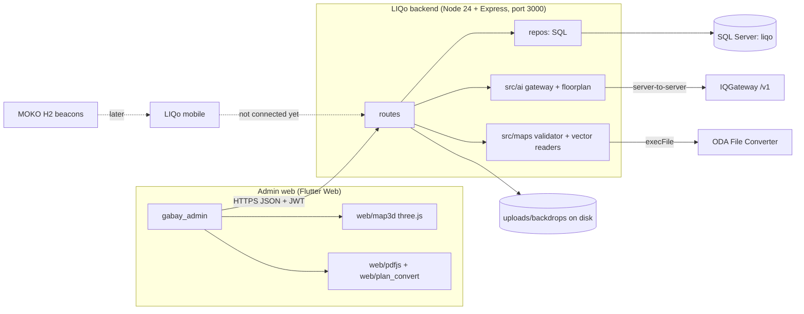

# LIQo — Master Blueprint

> **Version**: 1.0 | **Date**: 2026-10-22 | **Status**: Living document
> **Why**: `LIQO_PRD.md` · **How**: this file · **Where**: `FEATURE_PIPELINE.md`
> Written to `Engineering Standards.html` Appendix B.2. Filled from the code as it stands on 2026-10-22.

*You are reading the Master Architecture Document. You must strictly adhere to the constraints, tech stack, and logic defined in this file for all subsequent code generation, architecture decisions, and database queries.*

"Gabay" and "LIQo" are the same product. The admin web app's package is still `gabay_admin`.

Stable anchors: other documents cite `Blueprint §4.7` or `Blueprint Part 6 rule 6.12`. Sections are appended, never renumbered.

---

## Integration Summary

Architectural pivots, newest first. Each one says why, so nobody reopens it without new facts.

| Date | Pivot | Why |
|---|---|---|
| 2026-10-23 | Round 19: **AI credits per mall admin** (a share of the gateway wallet set aside per admin: start 3, cap 20, never more than the wallet; superadmins read from the free part). Reverses Round 15's "only the gateway wallet limits use". Profile requests became **Requests & reports** (profile changes, AI credit requests, problem reports). | Owner decision: the superadmin wants to set, see and monitor each admin's AI use. |
| 2026-10-22 | Round 17: a map now **starts from its floor plan**; a three.js 3D preview sits beside the 2D canvas. | Owner decision. US-036 needs a real 3D view; three.js allowed for this one use (`EXCEPTIONS.md` #2). |
| 2026-10-22 | Round 16: plans may be SVG, DXF or DWG, read on the server; DWG through ODA File Converter. | Owner decision. CAD gives exact walls and an exact scale. Settles user-story open item 3. |
| 2026-10-22 | Round 15: the free raster "Detect" was **removed** and replaced by AI reading through **IQGateway** (not the Anthropic API directly). Only the gateway wallet limits use; the platform's daily cap is no longer enforced. | Owner decision. One company gateway, one wallet, several AI providers. Settles user-story open item 2. |
| 2026-10-22 | Round 14: who a mall admin reports to is **computed**, never picked (`applyReportsToRule`). | Owner decision. Manual links went stale after ownership changes. |
| 2026-10-22 | Round 12: brand reference is `LIQO Brand Guidelines Presentation.png` (replaced the brand board). | Owner: "it is clearer". |
| 2026-10-21 | Round 7: list rows open **record pages**, not side panels (Round 5's panels removed). | Owner found the panel cramped. |
| 2026-10-21 | Round 4: the `supervisor` role is shown as **Mall owner**; the key stays `supervisor`. A mall admin manages exactly **one branch**. Owners may create admins (US-013 said they cannot). | Owner decisions. No migration and no API break for the rename. |
| 2026-10-21 | Auth is our own **JWT + bcrypt**, not Firebase Auth (US-001 says Firebase). | Owner decision for local development; Firebase/GCP is the later deploy target. |
| 2026-10-21 | Database is **SQL Server**, not PostgreSQL (US-047 says PostgreSQL). | The company standard mandates MSSQL; local SQL Server was already running. Production DB on GCP is still open (`EXCEPTIONS.md` #1). |
| 2026-10-21 | Map rules: "rulings" = **physical validity only** (no fire or accessibility codes); openings follow their host wall; one branch-wide metre grid. | Owner interview. Settles user-story open item 1 and most of open item 6. |

Conflicts between the user stories (`USER_STORY(ADMIN).md`) and this file are resolved in favour of the owner's later decisions above. The user-story file is not edited; this table is the record.

---

## Part 1 — System Directives & Constraints

```xml
<system_directive>
You build LIQo: an admin platform where malls keep their indoor maps, stores and
announcements, and a shopper app that uses those maps for indoor wayfinding.
Four admin roles (superadmin, mall owner = key "supervisor", mall admin, store owner)
and one public audience (shoppers). Every behaviour that is not decided in this file,
the PRD, a docs/round-N.md file or CLAUDE.md is asked of the owner, never invented.
</system_directive>
```

```xml
<tech_stack_constraints>
ALLOW
  Backend:  Node.js (ES modules) + Express + mssql driver, raw parameterized SQL, zod,
            jsonwebtoken, bcryptjs, helmet, cors, express-rate-limit, multer,
            pngjs/jpeg-js (pictures), dxf-parser, fast-xml-parser, svg-pathdata (plans).
  Database: Microsoft SQL Server (local). Production DB on GCP: open (EXCEPTIONS #1).
  Admin web: Flutter Web, Riverpod, go_router, dio, fl_chart, file_picker, package:web.
  Shopper app: Flutter (Android + iOS), Riverpod, go_router.
  JS inside the web app (EXCEPTIONS #2, #3): three.js for the 3D preview only; pdf.js,
            UTIF.js, pako, libheif-js for plan conversion only. All bundled, nothing loaded
            from outside.
  AI: IQGateway only, called only from the backend (src/ai/gateway.js).
  CAD: ODA File Converter, run by execFile without a shell (EXCEPTIONS #4).
DENY
  React/Vue/Angular, Python/PHP backends, PostgreSQL/MySQL/MongoDB, any ORM
  (Sequelize/Prisma/TypeORM), moment, Firebase Auth (decided against), calling an AI
  provider from the browser, loading any script from a CDN at run time.
PINNED (read from lockfiles / installed packages, 2026-10-22)
  Node 24.13.0 (LTS line; end of support 2028-04-30)
  express 4.22.3 · mssql 12.7.10 · zod 3.25.76 · jsonwebtoken 9.0.3 · bcryptjs 3.0.3
  helmet 8.3.0 · cors 2.8.6 · express-rate-limit 8.7.1 · multer 2.4.0 · dotenv 18.0.8
  dxf-parser 1.1.2 · fast-xml-parser 5.11.2 · svg-pathdata 9.0.0 · pngjs 7.0.0 · jpeg-js 0.4.4
  Flutter 3.47.5 stable · Dart 3.13
  web: flutter_riverpod 2.6.1 · go_router 18.1.1 · dio 5.11.1 · fl_chart 1.2.0
       file_picker 13.1.0 · shared_preferences 2.5.6 · intl 0.20.3 · web 1.1.1
  mobile (exact pins): flutter_riverpod 3.4.3 · go_router 18.0.2 · shared_preferences 2.5.6
       path_drawing 1.0.1 · collection 1.19.1 · url_launcher 6.3.3 · share_plus 13.3.1
  bundled JS: three.js 0.186.1 · pdf.js 5.7.284 · libheif-js 1.23.2
  Known drift (tracked in FEATURE_PIPELINE P1-11): Express 5 is the current major;
  the web app is on Riverpod 2 while mobile is on Riverpod 3; SQL Server edition and
  version not yet recorded here.
</tech_stack_constraints>
```

```xml
<routing_and_auth_constraints>
- API base /api. Open routes: /api/health, /api/auth/*. Everything else passes, in order:
  requireAuth → blockUntilPasswordChanged → auditWrites → router → requireRole (per route)
  → validate (zod) → resolveScope / assert*InScope → repo → recordAudit.
- JWT signed with JWT_SECRET, 8 h by default; the session timeout setting (1–72 h) applies.
  A deactivated account is refused on every request (requireAuth reloads the user).
- must_change_password blocks every route except change-password and me.
- Lockout: max_login_attempts failed sign-ins (default 5) lock the account (users.locked_until).
  Rate limits: 1200 req/min per IP on /api, 15 failed logins per 15 min on /api/auth/login.
- Passwords: bcrypt cost 10 (src/utils/password.js). Temporary passwords are shown once.
- requireRole(...) always lets a superadmin through.
- Error body is always { error }. Lists are { items, totalCount, page, pageSize }.
- Web routes per role: /superadmin, /mall-owner (old /supervisor links redirect),
  /mall-admin, /store-owner. Record pages are listed in core/router.dart _detailRoutes.
</routing_and_auth_constraints>
```

```xml
<compliance_context>
- Philippines Data Privacy Act of 2012 (Republic Act 10173), regulator: National Privacy
  Commission (NPC). Personal data held today: admin and store-owner names, emails,
  sign-in times, IP addresses in audit_log. Later: shopper accounts and positions.
  Obligations that shape design: collect only what a feature needs; secure it; keep it no
  longer than needed (retention periods are an open item, Part 3); report a personal-data
  breach to the NPC within 72 hours (NPC Circular 16-03); a Data Protection Officer is
  named by the company before launch (open item, PRD §8).
- Google Play and Apple App Store rules for the shopper app: location and Bluetooth
  permission prompts with a stated purpose, data-safety / privacy labels, no background
  location without a clear need. Applies from FEATURE_PIPELINE P1-09 / P2-02.
- No building-code, fire-safety or accessibility certification: map "rulings" mean physical
  validity only (owner decision 2026-10-21).
</compliance_context>
```

### Cross-cutting invariants & known traps

1. **Scope first.** Every scoped read and write calls `resolveScope(user)` (`src/utils/scope.js`). There is no company/tenant column; scope (malls → branches → stores) is the tenancy predicate.
2. **SQL lives only in `src/repos/`**, parameterized. Lists of ids go through `inList()`. Sort keys go through an allow-list.
3. **Dates.** `DATE` columns travel as `yyyy-MM-dd` strings. The pool runs with `useUTC: false` because `SYSDATETIME()` is server-local. Do not mix UTC and local clocks in one comparison.
4. **Migrations are frozen** once applied. Add a new numbered file. `node --watch` does not watch `.sql` files: run `npm run migrate` after adding one.
5. **Mall owner = `supervisor`.** Never rename the key; only words change.
6. **`reports_to` is computed** by `applyReportsToRule()` after every ownership or placement change. `PUT /accounts/:id/reports-to` answers 410.
7. **At least one active superadmin**, enforced inside one SQL statement (`users.deactivateKeepingASuperadmin`).
8. **The IQGateway key** exists only as `IQ_GATEWAY_KEY` in `LIQo backend/.env`. Never in responses, logs, audit or the web app.
9. **Colours** live only in `lib/core/theme.dart` (`Pal`). Blend with `p.pick` / `p.mix` / `p.darkOnly`; never `p.dark ? a : b` for a colour.
10. **No overlay portals in the map editor** (Tooltip, PopupMenuButton, MenuAnchor, Slider, OverlayPortal): they froze the page in debug mode.
11. **The shell never scrolls.** Each page scrolls inside its own `ShellPage`.
12. **Uploaded plans are stored on the local disk** (`LIQo backend/uploads/backdrops`). A container host with a throwaway disk (Cloud Run) loses them: deployment must move them to object storage first (FEATURE_PIPELINE P1-10).
13. **Node patch scripts:** use `split`/`join`, never `String.replace` with a replacement string containing `$'` (it inserts the rest of the file).

---

## Part 2 — Architectural Blueprint

### 2.1 Tenancy model

Single platform operator (Dynamiqes runs LIQo), many malls. No company/tenant table; whether a separate company or owner record is needed later is user-story open item 5 (still open).

```
mall ──< branch ──< store
          │           └── store_spaces (links to map spaces)
          └── map (one per branch) ──< map_versions
```

| Role (key) | Shown as | Scope (from `resolveScope`) | Can change |
|---|---|---|---|
| `superadmin` | Superadmin | everything | everything; another superadmin only deactivate / reactivate / reset |
| `supervisor` | Mall owner | malls assigned whole (all their branches, also later ones) + single branches; with `includeInactive` also their own inactive ones | a mall only when owned whole (`assertWholeMallOwner`); their branches; the admins that report to them |
| `mall_admin` | Mall admin | exactly one branch | that branch's info, stores, store owners, option lists, map, announcements; reviews store-owner announcements |
| `store_owner` | Store owner | assigned stores (read-only view of their branches) | announcement submissions for their stores |
| shopper | — | public, no account yet | nothing (shopper API not built, §4.19) |

Hierarchy: malls contain branches; whole-mall assignment covers branches created later. Deactivating a mall hides its branches; each branch keeps its own flag, so reactivating restores everything.

### 2.2 System diagram



Realtime transport: none. Clients poll or refresh; the map edit lock is renewed by a 60 s heartbeat.

### 2.3 Folder structures

```
LIQo/
  CLAUDE.md  EXCEPTIONS.md  LIQO_PRD.md  LIQO_MASTER_BLUEPRINT.md  FEATURE_PIPELINE.md
  USER_STORY(ADMIN).md  OFFICE_MAP_DESIGNER_SPEC.md  Engineering Standards.html
  docs/round-N-*.md            decision record per round (2–17)
  LIQo backend/
    src/server.js  app.js  config.js
    src/db/        pool.js  migrate.js  migrate-cli.js  seed.js  migrations/NNN_*.sql
    src/middleware/ auth  requireRole  validate  audit  errors
    src/routes/    auth accounts malls branches assignments settings ai audit lookups
                   announcements stores options owners maps backdrops profile analytics
    src/repos/     analytics announcements assignments audit backdrops branches malls maps
                   options owners profileRequests settings stores users
    src/utils/     scope ownership pagination password tokens dates redact
    src/maps/      catalog validator checks ids image  vector/{common,dxf,dwg,svg,render}
    src/ai/        gateway floorplan
    test/*.test.js  docs/TESTING.md  uploads/backdrops/
  LIQo web/
    lib/core/      api_client config router session theme theme_mode favicon*
    lib/shared/    forms/ (field_spec, field_builder, app_form_dialog, wizard_dialog, lookup_picker)
                   lists/list_scaffold  messaging/messages  nav/role_nav  models/ services/
                   widgets/ (app_shell, detail_widgets, skeleton, reveal_on_scroll, action_label,
                   logo_image, common)
    lib/features/  account accounts ai analytics announcements audit auth malls map_editor
                   overview profile_requests reports requests settings stores
    web/           map3d/ pdfjs/ plan_convert/ index.html favicons
    tool/crop_brand.mjs   test/ (incl. overflow_sweep_test, page_transition_test, support/fake_api)
  LIQo mobile/
    lib/core/      engine/ (venue, graph, routing, directions, reroute, kit/) i18n/ storage/ theme router
    lib/features/  home malls map navigation onboarding places saved search settings
    lib/shared/widgets/   test/{engine,logic,support}
```

### 2.4 Security layer (middleware order, `src/app.js`)

1. `trust proxy`, `x-powered-by` off, `helmet()`.
2. `cors`: any `http://localhost:*` in development; `CORS_ORIGINS` allow-list when set.
3. `express.json({ limit: '5mb' })`.
4. `Cache-Control: no-store` on `/api`.
5. Rate limits (off only with `RATE_LIMIT=off` for tests).
6. `/api/health`, then `/api/auth` (audits itself: login success and failure).
7. `requireAuth` → `blockUntilPasswordChanged` → `auditWrites` for every other router.
8. Per route: `requireRole` → `validate(zod)` → scope assertions → repo → `recordAudit`.
9. `notFound`, then `errorHandler` (`{error}`; zod errors become 400 with the first issue).

Audit redaction: `src/utils/redact.js` removes secrets (passwords, tokens) before any body is stored.

### 2.5 External integrations

| System | Used for | Where | Failure behaviour |
|---|---|---|---|
| IQGateway (`https://iqlicense.dynamiqes.com/v1`) | AI floor-plan reading; model list; wallet | `src/ai/gateway.js` | 401 → "key refused" (502); 402 → "credits used up"; 5xx → "failed or timed out". No key → AI routes 503. |
| ODA File Converter | DWG → DXF | `src/maps/vector/dwg.js` | Not configured → DWG refused: "save as DXF or PDF". 3 min limit. |
| pdf.js, UTIF.js, pako, libheif-js | PDF/TIFF/HEIC → PNG in the browser | `web/pdfjs`, `web/plan_convert` | "could not be read". |
| three.js | 3D preview | `web/map3d` | No WebGL → flat outline preview with a note. |
| MOKO Smart H2 beacons | Shopper positioning (later) | LIQo mobile | Not built (§4.20). |

### 2.6 Deployment topologies

| Topology | Status | Limits |
|---|---|---|
| Local development: SQL Server + `npm run dev` (3000) + `flutter run -d chrome` | In use | Single machine. |
| Internal test (owner, 2026-10-23): Firebase Hosting on Spark (web) + the API on a PC behind Cloudflare Tunnel + Firestore on Spark; files on that PC's disk | Planned (`EXCEPTIONS.md` #1, #4) | SQL Server stays for local development, with both data layers tested (`docs/shopper-hybrid-decisions.md` §4). Firebase Storage needs the Blaze plan, so files stay on the PC until real users come. Spark limits: ~50k reads / 20k writes per day, 1 GB. Phones need a stable tunnel address (named tunnel + domain). No runbook yet. |

---

## Part 3 — DB Schema Architecture

Source of truth: `LIQo backend/src/db/migrations/001`–`011`. There is no `schema.sql` with teardown yet (FEATURE_PIPELINE P1-11).

**Conventions.** `snake_case` tables and columns; `INT IDENTITY` keys except `map_backdrops` (32-char random key) and `platform_settings` (text key). Times are `DATETIME2` from `SYSDATETIME()` (server-local). Booleans are `BIT`.

**Audit columns.** Most tables carry `created_by` (INT, no foreign key), `created_at`, `updated_at`; reviewers carry `reviewed_by`/`reviewed_at`. Who did what is recorded in `audit_log`, not in history tables.

**Deliberate exclusions.**
- **No hard deletes of people or places.** Accounts, malls, branches, stores and option values are deactivated (`is_active`). Deletes exist only for option values not in use, announcements, uploaded plans and a whole map (superadmin).
- **No temporal/history tables.** `audit_log` is the history. Published maps are kept whole in `map_versions`.
- **No tenant column** (§2.1).
- **Store ↔ space links live outside the map document** (`store_spaces`), so linking never rewrites geometry and never travels with a copied map (US-019, US-043).
- **`map_conversions` has no foreign keys**, so a paid reading's cost record survives deleting its plan.
- **`created_by` and similar are plain INTs** without foreign keys, so deactivating or removing a link never blocks on history.

### 3.1 `users`
`id` PK · `email` NVARCHAR(255) UNIQUE · `password_hash` · `full_name` NVARCHAR(200) · `role` CHECK in (`superadmin`,`supervisor`,`mall_admin`,`store_owner`) · `is_active` BIT=1 · `must_change_password` BIT=1 · `last_login_at` NULL · `failed_logins` INT=0 (006) · `locked_until` NULL (006) · `reports_to` INT NULL FK→users (007) · `created_by`, `created_at`, `updated_at`.
Indexes: unique `email` (sign-in, wizard checks); `ix_users_reports_to` filtered `WHERE reports_to IS NOT NULL` (an owner's admins).

### 3.2 `platform_settings`
`setting_key` PK · `setting_value` NVARCHAR(500) · `updated_by`, `updated_at`.
Rows: `min_password_length` 8 (6–64), `ai_file_size_mb` 15 (1–100), `ai_daily_cap` 20 (**kept but not enforced since Round 15**), `ai_model` (chosen from the gateway), `default_announcement_days` 7 (1–365), `session_timeout_hours` 8 (1–72), `max_login_attempts` 5 (3–20). Ranges in `repos/settings.js` `RULES`; read through a 30 s cache with safe defaults.

### 3.3 `audit_log`
`id` PK · `actor_id` NULL · `actor_email` NULL · `action` NVARCHAR(100) · `entity_type`, `entity_id` NULL · `details` NVARCHAR(MAX) (redacted JSON) · `ip` · `created_at`.
Indexes: `ix_audit_created_at` (newest-first paging, analytics by day); `ix_audit_actor` (actor filter, team activity).
**Retention: open item.** One row per write, forever. A period must be chosen with the owner under RA 10173 (PRD open items).

### 3.4 `malls`
`id` PK · `name` UNIQUE · `logo_url` NULL (http/https only) · `is_active` · `created_by`, `created_at`, `updated_at`.

### 3.5 `branches`
`id` PK · `mall_id` FK→malls · `name` (UNIQUE with `mall_id`) · `logo_url` · `address` · `latitude`/`longitude` DECIMAL(9,6) (kept in the API, hidden on screens until the shopper app) · `opening_hours` NVARCHAR(300) · `contact_phone` · `contact_email` · `is_active` · audit columns.
Index: `ix_branches_mall` (branches of a mall, scope expansion).

### 3.6 `supervisor_assignments` (mall owners)
`id` PK · `user_id` FK · `mall_id` NULL FK · `branch_id` NULL FK · `assigned_by` · `assigned_at`. CHECK: exactly one of mall/branch.
Filtered unique indexes `uq_supassign_mall`, `uq_supassign_branch` (no duplicate links). `assigned_at, id` order decides the "first linked" owner for `reports_to`.

### 3.7 `mall_admin_assignments`
`id` PK · `user_id` FK · `branch_id` FK · `assigned_by` · `assigned_at`. UNIQUE (`user_id`,`branch_id`). The API allows one branch per admin (Round 4); the table does not enforce it.
Index: `ix_maassign_branch` (admins of a branch).

### 3.8 `branch_options`
`id` PK · `branch_id` FK · `kind` CHECK in (`store_category`,`unit_type`,`floor_label`) · `name` · `sort_order` · `is_active` · `created_at`, `updated_at`. UNIQUE (`branch_id`,`kind`,`name`). Delete is refused while in use.

### 3.9 `stores`
`id` PK · `branch_id` FK · `name` (UNIQUE with branch) · `category_id` NULL FK→branch_options · `logo_url` · `description` · `opening_hours` · `contact_phone` · `contact_email` · `is_active` · audit columns.
Index: `ix_stores_branch`.

### 3.10 `store_owner_assignments`
`id` PK · `user_id` FK · `store_id` FK · `assigned_by` · `assigned_at`. UNIQUE (`user_id`,`store_id`). Index `ix_soa_store`. An owner left with no stores is deactivated automatically (US-020).

### 3.11 `store_spaces`
`id` PK · `store_id` FK · `branch_id` FK · `space_key` NVARCHAR(40) (a space id inside the map document) · `created_at`. UNIQUE (`store_id`,`space_key`). Index `ix_ss_branch_space` (which store is on a space). Links to spaces that are not drawn are shown as "Not on map".

### 3.12 `announcements`, `announcement_branches`
`announcements`: `id` PK · `title` · `body` · `image_url` NULL (http/https link; upload not built) · `starts_on`, `ends_on` DATE (CHECK ends ≥ starts) · `status` CHECK in (`pending`,`approved`,`rejected`) · `store_id` NULL FK · `created_by` FK · `created_role` · `reviewed_by`, `reviewed_at`, `reject_reason` · `created_at`, `updated_at`. Index `ix_ann_status_dates` (live / upcoming / expired lists).
`announcement_branches`: PK (`announcement_id`,`branch_id`), cascade delete with the announcement; index `ix_ab_branch` (announcements of a branch). Detaching a shared post deletes only the caller's branch rows.

### 3.13 `maps`, `map_versions`
`maps`: `id` PK · `branch_id` FK UNIQUE (one map per branch) · `draft_json` NVARCHAR(MAX) · `draft_version` INT (stale-save check) · `published_version_id` NULL FK→map_versions · `lock_user_id`, `lock_expires_at` (5 min lock) · audit columns.
`map_versions`: `id` PK · `map_id` FK · `version` (UNIQUE with map; never rewound) · `layout_json` (published, backdrops stripped) · `space_count` · `note` · `published_by` · `published_at`. Rows are never updated.

### 3.14 `map_backdrops`
`backdrop_key` CHAR(32) PK · `branch_id` FK · `file_name` · `original_name` · `mime_type` · `size_bytes` · `width_px`, `height_px` · `uploaded_by`, `uploaded_at` · `source_kind` (`image` default; `svg`/`dxf`/`dwg`) · `source_file` · `units` · `mpp_from_units` DECIMAL(18,10) (011). Index `ix_backdrops_branch`. Files live in `uploads/backdrops/` (picture, original drawing, `<key>.vector.json`).

### 3.15 `map_conversions`
`id` PK · `branch_id` · `backdrop_key` · `level_id` · `used_ai` · `wall_count`, `space_count` · `requested_by`, `requested_at` · `model`, `credits` DECIMAL(18,4), `usd` DECIMAL(18,6), `crop` (010). Index `ix_conversions_day`. One row per paid call (retries included). **Retention: open item.**

### 3.16 `profile_requests`
`id` PK · `user_id` FK · `full_name` · `email` · `status` CHECK in (`pending`,`approved`,`rejected`,`cancelled`) default `pending` · `reason` · `reviewed_by`, `reviewed_at` · `created_at`.
Indexes: `ux_profile_requests_one_pending` filtered unique (one waiting request per person); `ix_profile_requests_status` (the review queue).

### 3.16a AI credits (012)
- `ai_credit_balances`: `user_id` PK FK · `balance` DECIMAL(12,4) · `full_mark` (the last top-up, for the bar) · `updated_at`.
- `ai_credit_ledger`: `id` · `user_id` FK · `delta` · `balance_after` · `kind` CHECK in (`start`,`grant`,`remove`,`reading`,`returned`,`request`) · `conversion_id` FK → `map_conversions` · `request_id` FK · `actor_id` · `note` · `created_at`. Indexes by user and by day.
- `ai_credit_requests`: `id` · `user_id` FK · `amount` > 0 · `status` CHECK in (`pending`,`approved`,`declined`,`cancelled`) · `decided_amount` · `decided_by` · `decline_reason` · `created_at`, `decided_at`. `ux_ai_credit_requests_one_pending` filtered unique.
- Settings `ai_start_credits` (3), `ai_credit_cap` (20); `ai_wallet_full`, `ai_wallet_last` keep the wallet's last top-up.

### 3.16b Problem reports (012)
- `problem_reports`: `id` · `reporter_id` FK · `type` CHECK in (`broken`,`wrong_data`,`question`,`idea`) · `subject` (120) · `body` (2000) · `page_path` · `status` CHECK in (`new`,`in_progress`,`resolved`,`closed`) · `created_at`, `updated_at`, `closed_at`, `closed_by`.
- `problem_report_messages`: `id` · `report_id` FK · `author_id` FK · `body` (2000) · `created_at`.

### 3.17 Growth

| Table | Grows with | Policy |
|---|---|---|
| `audit_log` | every write, sign-in, map editing stretch | **Open** — retention period to be decided (PRD open items) |
| `map_versions` | every publish / rollback | Kept forever (rollback needs them) |
| `map_conversions` | every paid AI call | **Open** (a clean-up must first clear `ai_credit_ledger.conversion_id`) |
| `ai_credit_ledger` | every credit change and paid reading | **Open** |
| `problem_reports` / messages | every report and reply | **Open** |
| `uploads/backdrops` | every uploaded plan | Deleted with the plan |

---

## Part 4 — Core Modules & Integration Mapping

Each module: purpose · rules · routes · files. User stories in brackets.

### 4.1 Authentication & sessions [US-001, US-002, US-004, US-046]
- Sign in with email and password; deactivated or locked accounts are refused with a clear message. Success and failure are audited by the auth route itself.
- Accounts start with a temporary password and `must_change_password`; nothing else works until it is changed. Password length follows `min_password_length`.
- Lockout after `max_login_attempts` failures. Session lifetime follows `session_timeout_hours`.
- No self-service reset: admins reset within their scope; the new temporary password is shown once.
- Routes: `POST /api/auth/login`, `GET /api/auth/me`, `POST /api/auth/change-password`, `POST /api/auth/logout`; resets under accounts and owners.
- Files: `routes/auth.js`, `middleware/auth.js`, `utils/password.js`, `utils/tokens.js`, `repos/users.js`; web `features/auth/`, `core/session.dart`. Tests `auth.test.js`, `scope.test.js`.
- Known issue: `generateTempPassword()` uses `Math.random`; switch to `crypto.randomInt` (FEATURE_PIPELINE P0-01 nested item).

### 4.2 Roles, scope & ownership [US-003, US-009]
- `resolveScope(user, { includeInactive })` returns `{all, mallIds, branchIds, storeIds, wholeMallIds}` (§2.1). `includeInactive` only widens a mall owner's scope, and only on mall/branch routes and the store and published-map read routes.
- `assertBranchInScope`, `assertMallInScope`, `assertStoreInScope`, `assertWholeMallOwner` throw 403.
- `applyReportsToRule()` recomputes every mall admin's superior: the owner of their branch first, else the mall's whole-mall owner, first linked (`assigned_at`, `id`), inactive owners skipped, else none. Audited once as `reports_to_recomputed` with the changes. Runs after owner assignment changes, adding/removing a mall owner, placing/moving/removing an admin, account creation, owner deactivation/reactivation.
- Files: `utils/scope.js`, `utils/ownership.js`, `repos/assignments.js`, `routes/assignments.js`, `routes/lookups.js` (`malls`, `branches`, `supervisors`, `free_mall_admins`, `stores`, `store_categories`, `mall_admins`). Tests `scope.test.js`, `reports_to_rule.test.js`, `people.test.js`, `mall_owner.test.js`.

### 4.3 Accounts & create wizards [US-006, US-013]
- Accounts are created only through step wizards: Role → Details → Access → Review → Done (superadmins skip Access; a fixed role skips Role). Store owners: Store → Details → Review → Done.
- `GET /accounts/check` runs while typing: email `free | taken | inactive | pending_request | store_owner | invalid`; full-name repeats; admins already on a branch. Taken or inactive email blocks Next; a repeated name, an email waiting in a profile request and a branch that already has admins only warn. Holder details go to a superadmin only.
- Superadmin manages everyone; another superadmin only deactivate / reactivate / reset. Owners manage only admins that report to them and whose branch is in their scope; they may create admins in their branches.
- Account roles cannot be changed after creation (FEATURE_PIPELINE P3-01).
- Routes: `/accounts` (list, create, check, get, put, deactivate, reactivate, reset-password; `reports-to` = 410).
- Files: `routes/accounts.js`, `repos/users.js`; web `features/accounts/` (`create_account_wizard.dart`, `account_checks.dart`, `assignment_dialog.dart`), `shared/forms/wizard_dialog.dart`. Tests `create_wizard.test.js`, `superadmin.test.js`. Decisions: `docs/round-2`, `round-4`, `round-8`, `round-10`.

### 4.4 Malls & branches [US-007, US-008, US-012, US-017]
- Only a superadmin creates malls and branches. After registering a mall the first-branch prompt opens (Later allowed).
- Deactivation shows its impact first (`GET /malls/:id/impact`, `/branches/:id/impact`) and uses the typed confirmation.
- Mall changes need whole-mall ownership. Owners keep seeing their own inactive malls and branches and can reactivate them.
- Owners and admins of a mall are managed on the mall page (`GET /malls/:id/people`, owners add/remove, admins put/delete).
- Logos are `http(s)` links with an initials fallback. Latitude/longitude stay in the API, hidden on screens. Partial branch PUTs keep unsent fields.
- Files: `routes/malls.js`, `routes/branches.js`, `repos/malls.js`, `repos/branches.js`; web `features/malls/`. Decisions: `round-2`, `round-4`, `round-7`, `round-9`, `round-14`.

### 4.5 Stores, store-space links & store owners [US-018, US-019, US-020, US-024]
- A store belongs to one branch; name unique per branch; category from the branch's option list.
- Store ↔ space links are many-to-many and live in `store_spaces` (`PUT /stores/:id/spaces`). AI reading can link matched stores after the draft saves.
- A store owner is created through a store assignment; one owner can hold many stores. An owner left with no stores is deactivated automatically. An inactive store owner's email is refused (409).
- Mall owners read stores (and published maps) of their branches, including inactive ones, never write.
- Files: `routes/stores.js`, `routes/owners.js`, `repos/stores.js`, `repos/owners.js`; web `features/stores/` (`store_owner_wizard.dart`). Tests `flows.test.js`.

### 4.6 Branch option lists [US-021]
- Per branch: `store_category`, `unit_type`, `floor_label`. Values are deactivated, or deleted only when unused. Changing a value never rewrites stores that use it.
- Files: `routes/options.js`, `repos/options.js`; web `features/stores/options_view.dart`, `option_detail_view.dart`.

### 4.7 Announcements [US-016, US-022, US-025, US-044]
- Fields: title, body, optional image link, start/end dates, target branches (in scope), optional store. A new announcement cannot already be over. Default length `default_announcement_days`.
- Store-owner submissions start `pending`; **only mall admins** (or a superadmin) approve or reject them (reject needs a reason).
- Shared announcements (targets inside and outside someone's scope): each manager sees only their own branches; only the author, someone covering all targets or a superadmin can change it; others can only take it off their branches (`announcement_detached`). Logic: `managerAccess()` / `present()`.
- Visible as active only when approved, in period and in scope. Shopper delivery is not built (§4.19). Image upload is not built.
- Routes: `/announcements` (list, defaults, get, post, put, delete/detach, `/:id/approve`, `/:id/reject`).
- Files: `routes/announcements.js`, `repos/announcements.js`; web `features/announcements/`. Tests `owner_round14.test.js`, `flows.test.js`.

### 4.8a Requests & reports, problem reports [Round 19]
- One superadmin page with tabs and waiting counts (`GET /requests/counts`): profile changes (§4.8), AI credit requests (§4.15a), problem reports. The sidebar count is the total.
- Problem reports: mall owners, mall admins and store owners send one from the top bar (type, subject, description, the page). A thread with the superadmin; statuses only move forward (new → in progress → resolved or closed); no messages after. Reporters see theirs in My account. All audited.
- Routes: `/reports` (post, mine, list, get, messages, status), `/requests/counts`. Files: `routes/reports.js`, `repos/reports.js`; web `features/requests/`, `features/reports/`. Test `reports.test.js`. Decisions: `round-19`.

### 4.8 Profile change requests [Round 8]
- A superadmin changes their own name and email at once. Everyone else sends a request; one waits at a time (filtered unique index); a superadmin approves (applied in one transaction, email re-checked) or rejects with a reason.
- Routes: `/profile` (put, access, request get/post/delete), `/profile-requests` (list, get, approve, reject).
- Files: `routes/profile.js`, `repos/profileRequests.js`; web `features/account/`, `features/profile_requests/`. Test `profile.test.js`.

### 4.9 Analytics & overview [US-005, US-015, US-023]
- `GET /analytics/overview` (cards, recent activity, quick actions; owners also see their team's actions). `GET /analytics/report?days=7|30|90`: activity by day, stores, accounts, announcements, map coverage, sign-in security (superadmin only). Every query is scoped.
- Map editing sessions come from a `map_edited` audit entry written once per 10-minute stretch of saves.
- Real CSV export of the breakdown tables. No store-owner analytics page. No shopper metrics (no data source yet).
- Files: `routes/analytics.js`, `repos/analytics.js`; web `features/analytics/` (`charts.dart`, `csv_export.dart`), `features/overview/`. Test `analytics.test.js`. Decision: `round-3`.

### 4.10 Audit trail [US-011, US-045]
- `auditWrites` records every successful write on finish unless the handler already wrote a named entry with `recordAudit()`. Secrets are redacted. Entries are never edited through the app.
- `GET /audit` (paged; `from`, `to`, `actor`, `action`), `GET /audit/actions`. Superadmin only. Readable names through `shared/widgets/action_label.dart`.
- Gap: the web page has no user filter although the API accepts `actor` (FEATURE_PIPELINE P0-02 nested item).
- Files: `middleware/audit.js`, `repos/audit.js`, `routes/audit.js`, `utils/redact.js`; web `features/audit/`.

### 4.11 Platform settings [US-010]
- Superadmin edits the settings in §3.2 in two columns (AI floor-plan reading; one card with Sign-in & security and General) with one save bar; out-of-range values are refused with the setting's label. The AI tile chooses `ai_model` from the gateway's available chat models (`PUT /ai/model`, audited `ai_model_changed`), shows the wallet with what is given and free, and holds the starting credits and cap.
- Files: `routes/settings.js`, `repos/settings.js`, `routes/ai.js`; web `features/settings/`, `features/ai/`.

### 4.12 Map document, validator & catalog [US-026–US-031, US-038]
- One JSON document per branch: buildings (origin + rotation) → levels (elevation, optional offset + rotation, outline polygon with holes) → walls, openings, spaces, features; connectors join level endpoints across buildings. Units metres; x across, z down the plan; one branch-wide grid. Full model: `OFFICE_MAP_DESIGNER_SPEC.md` as revised by the owner's map decisions (Integration Summary).
- Catalog (`src/maps/catalog.js`, version 1): space types `retail, food, anchor, service, office, storage, atrium, corridor, restroom, parking, outdoor, custom`; wall kinds `solid, glass, partition, boundary`; opening kinds `door, entrance, window, gate, passage, shutter`; connectors `stairs, escalator, elevator, ramp, moving_walkway, bridge, walkway, vehicle_ramp` (one-way capable: escalator, moving walkway, ramp, vehicle ramp); feature types by category (access, facilities, safety, services, furniture, structure, generic).
- `validateLayout` (pure): canonical copy (unknown fields dropped, numbers to 1 mm); **structural problems block every save**; **completeness problems block publishing only**. Limits: 8 MB, 20 buildings, 30 levels each, 5 000 walls / openings, 2 000 spaces, 10 000 features per level, 500 connectors, ±5 000 m. `checks.js` adds non-blocking warnings.
- Openings belong to their host wall: same fraction when the wall moves or changes, stay on the piece they land on after a split, deleted with the wall. Detailed opening rules beyond these are user-story open item 6 (still open).
- Files: `src/maps/validator.js`, `catalog.js`, `checks.js`, `ids.js`; web `features/map_editor/map_models.dart`, `properties_panel.dart`, `map_canvas.dart`.

### 4.13 Map editing lifecycle [US-037, US-039–US-043]
- Create: mall admins of the branch (`POST /maps/:branchId`, `outline: false` allowed when starting from a plan). Only a superadmin deletes a map.
- Lock: one editor at a time, 5 min, renewed every 60 s; others view only; a superadmin can force-release (`map_lock_force_released`).
- Draft save: autosave 1.5 s after edits stop, plus manual save; sends `baseVersion`; a stale save gets 409 and is never merged or retried.
- Publish: server validation; blocked on completeness problems; a new immutable `map_versions` row and an atomic switch; draft-only backdrops stripped (`publishable()`); publisher and time recorded.
- Versions & rollback: rollback creates a new version from an old one (counter never rewound); backdrops re-attached to the draft (`reattachBackdrops()`).
- Copy to another branch: separate document, ids regenerated, store links not copied.
- Undo/redo: a drag or an applied AI proposal is one step. **Gap:** no screen lists the undo history (US-037 asks to inspect it); the History dialog lists published versions only.
- Mall owners get a slim read-only response (no draft, lock, versions or warnings) and the viewer (`map_viewer_view.dart`, `?branch=`, store list panel).
- Files: `routes/maps.js`, `repos/maps.js`; web `map_editor/editor_state.dart`, `map_editor_view.dart`, `map_viewer_view.dart`, `store_list_panel.dart`. Tests `flows.test.js`, `maps_create.test.js`, web `map_canvas_test`, `map_create_test`.

### 4.14 Plan upload, formats & calibration [US-032, US-033]
- The server sniffs the type from the bytes. PNG/JPG stored as they are. PDF/TIFF/WebP/BMP/GIF/HEIC are turned into PNG in the browser first. SVG/DXF/DWG are read on the server and drawn into our own PNG; the original and `<key>.vector.json` are kept. SVG is never served back as SVG.
- Scale: DXF/DWG exact from their unit (`mpp_from_units`), or the unit the admin picks (`PUT .../backdrops/:key/unit`); everything else by two-click calibration. Backdrops can be moved, rotated, faded and locked; they are draft-only.
- Limits: `ai_file_size_mb`; pictures ≤ 10 000 px a side and 50 MP; drawings ≤ 400 000 lines, 20 000 texts, 2 000 layers, 12 nesting levels; rendered PNG ≤ 6 000 px and 24 MP.
- Routes: `/maps/:branchId/backdrops` (list, upload, get picture, delete, unit, convert). Upload, delete, unit and convert are mall-admin routes.
- Files: `routes/backdrops.js`, `repos/backdrops.js`, `src/maps/image.js`, `src/maps/vector/*`; web `map_editor/plan_upload.dart`, `blueprint_panel.dart`, `pdf_*.dart`, `picture_convert*.dart`, `web/pdfjs`, `web/plan_convert`. Test `plan_formats.test.js`, `image.test.js`. Decisions: `round-15`, `round-16`, `round-17`.

### 4.15 AI floor-plan reading [US-034, US-035]
- Mall admins (and superadmins) read a whole plan or a boxed part. The server crops, shrinks to ≤ 2 000 px, draws the reference grid, and sends the picture, its size in metres, the branch's store names and a strict JSON schema to IQGateway with the `ai_model` setting. CAD plans also send layers and texts; `snapToCad()` lays walls on the exact CAD lines.
- The answer is checked by zod (one retry on unreadable JSON), tidied (spec §10.4), mapped through the calibration, validated inside a copy of the draft, and matched to stores (score ≥ 0.8).
- The result is only a **proposal**: teal on the canvas, unsure pieces amber; accepted as one undo step; never published automatically.
- Every paid call is a `map_conversions` row and an audit entry (`map_converted` / `map_convert_failed`) with its cost. Since Round 19 a mall admin needs credits of their own (§4.15a); a superadmin reads from the wallet's free part.
- Full-screen scan dialog while reading; new pieces draw themselves in.
- Files: `src/ai/gateway.js`, `src/ai/floorplan.js`, `routes/ai.js`, `routes/backdrops.js`; web `features/ai/`, `map_editor/ai_scan_dialog.dart`, `blueprint_panel.dart`. Tests `ai_reading.test.js`, `floorplan.test.js` (fake gateway only).
- Not proven live: no paid reading has run (wallet empty, model not chosen).

### 4.15a AI credits per mall admin [Round 19]
- A balance is a share of the gateway wallet set aside for one mall admin; giving moves no money. Given = active admins' positive balances; Free = wallet − given.
- Giving (grant, approved request, start credits) checks the cap (`ai_credit_cap`), that given never exceeds the wallet, and refuses everything while over-given; all writes in one transaction under an application lock. Removing never goes below 0.
- A reading: refused at a balance ≤ 0 (mall admin) or with nothing free (superadmin); the paid cost is taken after (may end slightly below 0), linked to its `map_conversions` row.
- New mall admins (and reactivated ones) get `ai_start_credits` as far as free; deactivation returns credits and cancels the open request. Existing admins started at 0.
- Requests: an amount, one open per admin; approved (maybe less) or declined by a superadmin.
- Who sees: superadmin all (Analytics: wallet split, admins table with Add/Remove, credits per day, history); mall owner their admins, read only; mall admin only their own (My account, the editor).
- Routes: `/ai/credits` (overview, history, `:userId/adjust`, mine, requests...). Files: `src/ai/credits.js`, `src/ai/creditOps.js`, `repos/credits.js`, `routes/credits.js`; web `features/ai/credits_service.dart`, `my_credits.dart`, `features/analytics/credits_section.dart`. Test `ai_credits.test.js`. Decisions: `round-19`.

### 4.16 3D preview [US-036]
- Always beside the 2D canvas (collapsible, divider 25–65%). Walls, doors, rooms, outline slab, features, connectors, all levels stacked with the current one solid; AI proposal in teal; pieces named in warnings in the danger colour, never hidden. Without WebGL a flat outline preview with a note.
- Drag to turn, wheel to zoom, right-drag to slide, Reset view. Editing stays in 2D. The scene follows edits at most every 150 ms; only changed levels are rebuilt.
- Files: `web/map3d/model.js` (pure, tested in Node), `web/map3d/map3d.js`, `web/map3d/three/`; web `map_editor/map3d_panel.dart`, `map3d_host*.dart`. Tests `map3d_model.test.js`, web `round17_test.dart`.

### 4.17 Web UI platform
- Brand: Obsidian dark mode, light mode its inversion, Manrope; tokens only in `Pal` (`lib/core/theme.dart`); brand images only from `tool/crop_brand.mjs`; mark "IQ"; tagline "Smart Way Forward".
- Motion: theme colours morph in 450 ms (`Pal` is a `ThemeExtension`); pages "instant out, soft in" (`_InstantOutSoftIn`); charts reveal when scrolled into view; reduced motion respected everywhere.
- Structure: lists have no row menus; rows open record pages built from `detail_widgets.dart` (`DetailScaffold`, `DetailCard`, `RecordRow`, `DangerZone` with `confirmDangerous`); forms from `FieldSpec`s; messages through the shared overlay; errors through `formatApiError`; loading shows a skeleton of the page's own shape.
- Login: form card beside a 4-slide feature carousel, glass panel and card, living background on one 24 s clock.
- Layout guard: `test/overflow_sweep_test.dart` (every page × role × ten widths, loaded, loading, half-loaded); `test/page_transition_test.dart` (16 ms steps).
- Decisions: `round-5` to `round-7`, `round-11` to `round-13`.

### 4.18 Mobile shopper app
- Flutter app `liqo_mobile` (`com.dynamiqes.liqo`, Android + iOS), ported from `demo_app` ("Gabay Demo"). Offline engine (venue, walkway graph, routing fastest/shortest, directions, rerouting) with three sample malls; Home with categories and sample posts; Map with simulated walk; Saved; More (settings, Tagalog, evacuation). Login and sign-up are look-only.
- Not connected to the backend yet; no real positioning. Next: hybrid offline/online per `docs/shopper-hybrid-decisions.md` (downloaded branches work offline; directory, live store info, posts and anonymous counts online).
- Files: `LIQo mobile/lib/core/engine/*`, `lib/features/*`. Tests `test/engine`, `test/logic`.

### 4.19 Shopper integration API — not built
Decided 2026-10-23 (`docs/shopper-hybrid-decisions.md`): public, read-only `/api/shopper/*` routes mounted before the sign-in middleware, never audited, own per-IP limiter (stricter on counts), serving the directory, an immutable per-version shopper package built at publish (`src/maps/shopper/`, same transaction; publish refused for unwalkable maps), live store info and out-of-service marks, approved announcements, and receiving anonymous counts. A written exception to the `utils/scope.js` rule. Built after the Firestore data layer. Every current route still needs an admin sign-in.

### 4.20 Beacon positioning — not built
Reserved for MOKO Smart H2 BLE beacons in the shopper app. Placement, calibration, data model and admin tooling undecided.

---

## Part 5 — MVP Development & Release Roadmap

Mirrors `LIQO_PRD.md` §9 row for row. No dates: each milestone ends when its gate passes.

| Milestone | Phase | Key activities & deliverables | State |
|---|---|---|---|
| M1 | Foundation | Auth, sessions, lockout, roles and scope, audit, settings | Done |
| M2 | Role dashboards | Superadmin, mall owner, mall admin, store owner; announcements; profile requests; analytics; UI platform | Done |
| M3 | Map editor core | Geometry, openings, spaces, features, connectors, issues, lock, save, publish, versions, rollback, copy | In progress (undo-history view) |
| M4 | Plans, AI and 3D | Plan upload in all formats, AI reading via IQGateway, 3D preview | Built; waiting on owner steps |
| M5 | Engineering baseline | Git repo, CI gates, document set, test manuals, version currency | Planned |
| M6 | Shopper integration | Shopper API, map publish/sync to mobile, mobile app port | In progress / blocked on owner decisions |
| M7 | Pilot deployment | Firebase Hosting + Cloud Run + production DB, plan storage, runbook, one mall group | Planned |
| M8 | After pilot | Beacon positioning, role analytics redesign, posts feed, account role change | Planned |

---

## Part 6 — Feature Development Guidelines

Named rules. Control kinds: **test** (deterministic, fails `npm test` / `flutter test`), **lint** (`flutter analyze`), **review** (code-review item), **human** (owner decision). The only git hook so far is `.githooks/pre-commit` (refuses `.env` files and uploaded floor plans); there is no CI yet (FEATURE_PIPELINE P1-11). Every "review" rule is a candidate for a hook or a CI check.

| # | Name | Rule | Failure it prevents | Files | Enforcer / kind |
|---|---|---|---|---|---|
| 6.1 | The Scope Rule | Every scoped read and write goes through `resolveScope` and an `assert*InScope`. | A role reading or changing another branch's data. Round 9: a single-branch owner could rename or deactivate the whole mall. | `utils/scope.js`, every route | `scope.test.js`, `mall_owner.test.js` · test |
| 6.2 | The Repo Rule | SQL only in `src/repos/`, parameterized; id lists via `inList()`. | SQL injection; SQL scattered in routes. | `src/repos/*` | review |
| 6.3 | The Frozen Migration Rule | Never edit an applied migration; add `NNN_*.sql`; run `npm run migrate`. | Databases that differ by machine. | `src/db/migrations/` | review (hook planned) |
| 6.4 | The Computed Superior Rule | `reports_to` is never set by hand; call `applyReportsToRule()` after any ownership or placement change. | Stale links after owners change (Round 14). | `utils/ownership.js`, `repos/assignments.js` | `reports_to_rule.test.js`; route answers 410 · test |
| 6.5 | The Whole-Mall Rule | Changing a mall needs whole-mall ownership (`assertWholeMallOwner`). | Round 9 permission hole. | `routes/malls.js` | `mall_owner.test.js` · test |
| 6.6 | The Last Superadmin Rule | Deactivating a superadmin is one conditional SQL statement that keeps one active. | Locking everyone out, also when two deactivate each other at once. | `repos/users.js` | review (no test: needs real accounts) |
| 6.7 | The Key Stays Home Rule | `IQ_GATEWAY_KEY` only in backend `.env`; the browser calls only our `/ai/*` and convert routes. | Leaked AI key and wallet abuse. | `config.js`, `src/ai/gateway.js` | `ai_reading.test.js` checks responses · test |
| 6.8 | The Fake Gateway Rule | Tests use a fake gateway and a fake ODA converter; never real credits. | Paying for test runs. | `test/ai_reading.test.js`, `plan_formats.test.js` | review |
| 6.9 | The Proposal Rule | AI output is a proposal: validated, reviewable, one undo step, never auto-published. | AI changing a live map. | `floorplan.js`, `editor_state.dart` | `round15_test.dart` · test |
| 6.10 | The Token Rule | Colour literals only in `lib/core/theme.dart`; blend with `p.pick`/`p.mix`/`p.darkOnly`; `p.dark` only for labels, icons, image paths. | Colours jumping mid-morph; off-brand colours. | `core/theme.dart` | `theme_transition_test.dart` (partial) · test + review |
| 6.11 | The Sweep Rule | Every page renders without overflow at ten widths, loaded, loading and half-loaded; fixed-width children in a `Row` need `Flexible`/`ShrinkTo`; button rows use `Wrap`; no charts or `LayoutBuilder` in `TwoCol`/`GridRows`. | Round 3: `IntrinsicHeight` assertion with fl_chart; ~20 overflow sites found 2026-10-21. | `test/overflow_sweep_test.dart`, `support/fake_api.dart` | test |
| 6.12 | The Own-Scroll Rule | The shell never scrolls; each route wraps its page in `ShellPage` inside the transition. | 2026-10-22: Overview overflowed by 459 px during page fades. | `core/router.dart`, `app_shell.dart` | `page_transition_test.dart` · test |
| 6.13 | The Portal Rule | No Tooltip, PopupMenuButton, MenuAnchor, Slider or OverlayPortal inside the map editor. | 2026-10-21: three page freezes in debug mode. | `features/map_editor/*` | review (`overlay_repro_test` skipped) |
| 6.14 | The One Page Rule | Page changes are instant out, soft in; never two pages on screen. | Overlapping pages during fades. | `core/router.dart` `_InstantOutSoftIn` | `theme_transition_test.dart`, `page_transition_test.dart` · test |
| 6.15 | The Skeleton Rule | A waiting page shows a shimmer skeleton of its own shape (relative sizes), never a spinner. | Layout jumps; overflow while loading. | `shared/widgets/skeleton.dart` | sweep loading pass · test |
| 6.16 | The Record Page Rule | No row menus; rows open the record's page; one `DetailCard` per section; `DangerZone` last with typed confirmation. | Hidden actions; accidental deactivations. | `shared/widgets/detail_widgets.dart`, `core/router.dart` | review |
| 6.17 | The Wizard Rule | Accounts are created only through the step wizards with live checks. | Duplicate or orphan accounts. | `create_account_wizard.dart`, `store_owner_wizard.dart` | `create_wizard_test.dart` · test |
| 6.18 | The FieldSpec Rule | Forms are built from `FieldSpec`s; no bare `TextFormField`. | Forms drifting from validation. | `shared/forms/*` | review |
| 6.19 | The One Voice Rule | No `ScaffoldMessenger.showSnackBar`; use the shared message overlay; errors through `formatApiError`. | Raw exceptions shown to people. | `shared/messaging/messages.dart` | review |
| 6.20 | The Brand Asset Rule | Brand images come only from `node "LIQo web/tool/crop_brand.mjs"`; never edited by hand. | Halos, uneven logo sizes between modes. | `assets/brand`, `web/` icons | review |
| 6.21 | The Login Clock Rule | Login-page tests step time with `pump(duration)`; the page never settles. | Tests hanging on `pumpAndSettle`. | `test/login_test.dart` | review |
| 6.22 | The Reduced Motion Rule | Every animation (charts, login, scan, 3D damping) stops or jumps to its end with reduced motion. | Motion sickness; unstable tests. | animated widgets | `login_test.dart`, `round17_test.dart` · test |
| 6.23 | The split/join Rule | Node patch scripts use `split`/`join`, never `String.replace` with `$'` in the replacement. | Corrupted `test/support/fake_api.dart` once. | any patch script | review |
| 6.24 | The Ask First Rule | Behaviour not decided in a document is asked of the owner; undecided parts stay unbuilt. | Rework from guessed rules (2026-10-21). | — | human |
